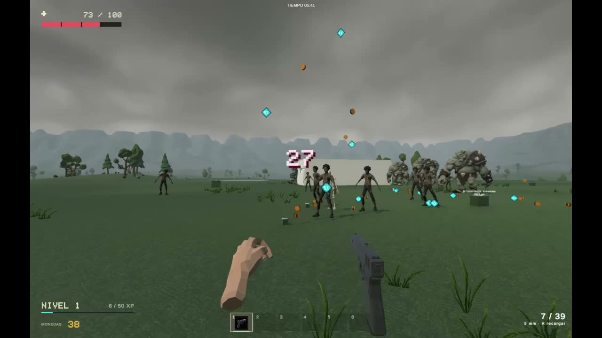

# Juego de oleadas

Prototipo de acción en primera persona hecho en **Unity 3D**. El objetivo es sobrevivir a oleadas de enemigos en un escenario abierto.

## Qué incluye

- Combate en primera persona con arma de fuego.
- Enemigos que se acercan en grupo y números de daño al impactar.
- Interfaz con indicadores de salud, nivel y munición.

## Captura

## Video

[Ver o descargar la demostración de 26 segundos](docs/vc.mp4)

## Cómo jugar en Windows

1. Descargá el repositorio como ZIP desde **Code → Download ZIP** y extraelo.
2. Abrí `My project.exe` desde la carpeta extraída.
3. Conservá el ejecutable junto a las carpetas y bibliotecas incluidas.

El repositorio contiene la versión compilada para Windows. Podés ejecutarla sin instalar el editor de Unity.
